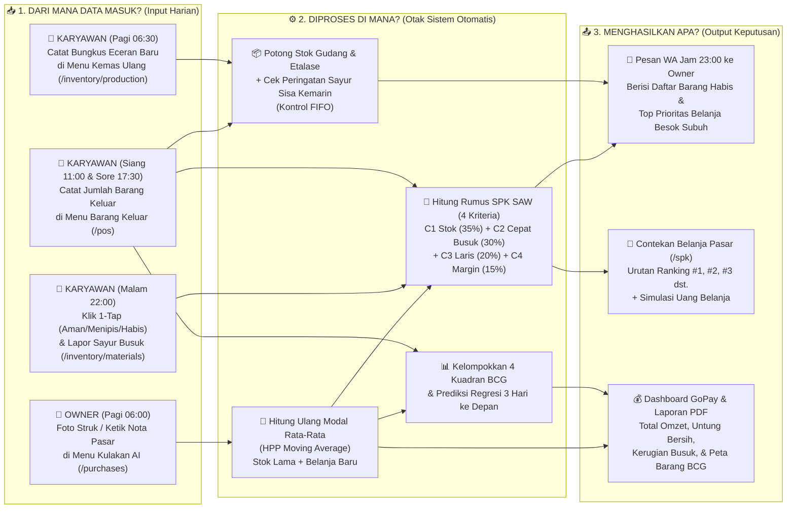
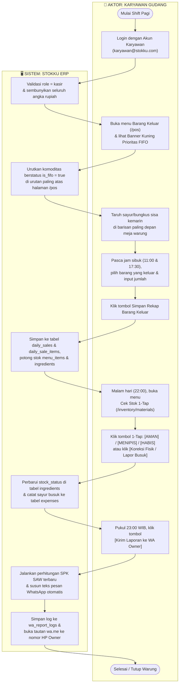
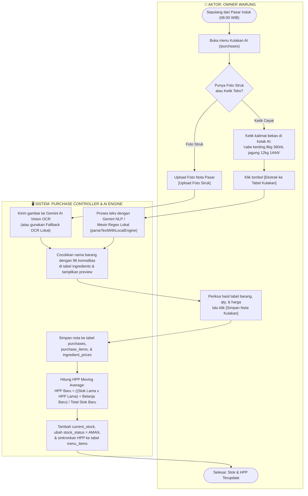
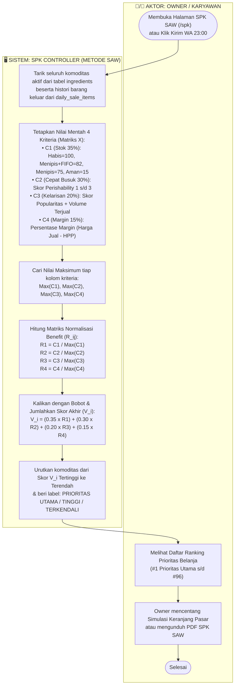
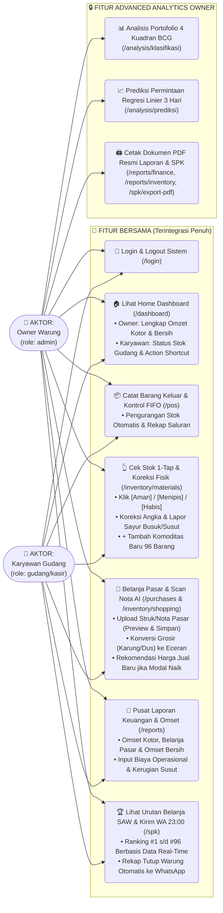
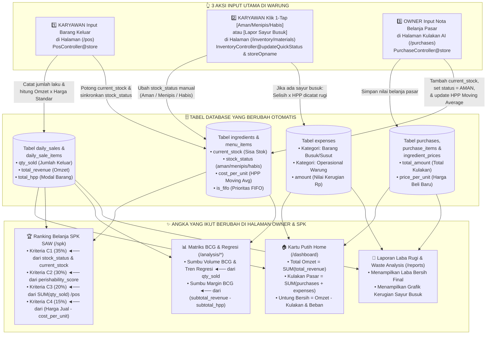

# 🗺️ DOKUMENTASI VISUAL: FLOWCHART & DIAGRAM SISTEM STOKKU ERP
## Studi Kasus: Warung Sayur Adijaya (96 Komoditas Segar & Sembako)

> **💡 Kunci Utama Agar Tidak Bingung Memahami Proyek Ini:**
> Bayangkan aplikasi **STOKKU ERP** ini seperti **Buku Catatan Gudang Pintar + Asisten Belanja Pasar**.
> * Aplikasi ini **BUKAN mesin kasir Indomaret** (tidak dipakai saat ibu-ibu sedang antre bayar sayur di jam sibuk pagi 07:00–11:00 WIB).
> * **Karyawan** hanya bertugas mencatat **fisik barang** (barang yang dikemas ulang, barang yang keluar/laku, barang yang habis di rak, dan sayur yang busuk), lalu jam 23:00 malam klik tombol **Kirim WA ke Owner**.
> * **Owner** hanya bertugas memasukkan **nota belanja pasar pagi** dan memantau **Untung Bersih, Urutan Belanja SAW, serta Klasifikasi Barang BCG**.

---

## 1. PETA KONSEP "1 HALAMAN" (BIG PICTURE STOKKU ERP)

Diagram blok paling sederhana ini menjawab pertanyaan: **"Dari mana data masuk, diproses di mana, dan menghasilkan apa?"**

### Penjelasan Bahasa Sehari-hari:
1. **Bagian Kiri (Input):** Hanya ada **4 kegiatan input** di warung: Owner masukkan nota pasar pagi, Karyawan catat bungkus eceran, Karyawan catat barang yang laku keluar pas warung senggang, dan Karyawan pencet tombol `Aman/Menipis/Habis` pas malam.
2. **Bagian Tengah (Proses):** Begitu 4 data tadi masuk, komputer otomatis menghitung rata-rata harga modal baru (*Moving Average*), memotong sisa stok, dan menjalankan rumus **SAW** serta **BCG**.
3. **Bagian Kanan (Output):** Hasilnya langsung jadi **Pesan WA jam 11 malam**, **Daftar Prioritas Belanja Pasar Subuh**, dan **Hitungan Untung Bersih Owner**.

---

## 2. FLOWCHART ALUR HARIAN WARUNG DARI SUBUH SAMPAI TUTUP (05:00 – 23:00 WIB)

Flowchart ini menggambarkan urutan waktu dari subuh saat Owner ke pasar induk hingga warung tutup pukul 23:00 WIB, memisahkan tugas **Owner** dan **Karyawan**:

```mermaid
flowchart TD
    START(["🌅 MULAI: Pukul 04:30 - 05:30 WIB\nOwner Berangkat ke Pasar Induk"]) --> SUBUH

    SUBUH["👑 OWNER membuka WA Laporan Semalam\natau halaman SPK SAW (/spk)\nMelihat Urutan Barang Prioritas #1, #2, #3"] --> PAGI_OWNER

    PAGI_OWNER["👑 Pukul 06:00 WIB - Barang Datang di Warung\nOwner buka menu Kulakan AI (/purchases)\nFoto Struk Pasar atau Ketik Kalimat Cepat\nKlik tombol: SIMPAN NOTA KULAKAN"] --> EFEK_KULAKAN

    EFEK_KULAKAN["⚙️ Efek Sistem Otomatis:\n1. Stok Gudang (ingredients) Bertambah\n2. Status Stok jadi AMAN (Hijau)\n3. HPP Moving Average Dihitung Ulang"] --> PAGI_KARYAWAN

    PAGI_KARYAWAN["👷 Pukul 06:30 WIB - Persiapan Meja Depan\nKaryawan buka menu Kemas Ulang (/inventory/production)\nMembungkus cabai/bawang/sayur eceran\nKlik tombol: SIMPAN KEMAS ULANG"] --> JAM_SIBUK_PAGI

    JAM_SIBUK_PAGI["🔥 Pukul 07:00 - 11:00 WIB (JAM SIBUK PAGI)\nIbu-ibu ramai belanja sayur.\nKaryawan fokus layani pembeli secara tunai\n& menjual stok bungkus sisa kemarin (FIFO) duluan\n(Aplikasi TIDAK dipakai ketik kasir agar tidak antre)"] --> SIANG_REKAP

    SIANG_REKAP["👷 Pukul 11:00 - 14:00 WIB (Warung Senggang)\nKaryawan buka menu Barang Keluar (/pos)\nPilih barang yang keluar pagi tadi & isi jumlahnya\nKlik tombol: SIMPAN REKAP BARANG KELUAR"] --> EFEK_POS_SIANG

    EFEK_POS_SIANG["⚙️ Efek Sistem Otomatis:\n1. Stok Etalase & Gudang Berkurang\n2. Data Kelarisan Barang (C3 SAW) Bertambah\n3. Estimasi Omzet & Untung Owner Terhitung"] --> JAM_SIBUK_SORE

    JAM_SIBUK_SORE["🔥 Pukul 14:00 - 17:30 WIB (JAM SIBUK SORE)\nPelayanan pembeli sore hari"] --> SORE_REKAP

    SORE_REKAP["👷 Pukul 17:30 - 21:00 WIB\nKaryawan rekap lagi Barang Keluar sore di (/pos)"] --> MALAM_CEK

    MALAM_CEK["👷 Pukul 21:30 - 22:30 WIB (Cek Rak Malam)\nKaryawan buka menu Cek Stok 1-Tap (/inventory/materials)\n• Klik tombol [AMAN] / [MENIPIS] / [HABIS]\n• Jika ada sayur layu, klik [Koreksi Fisik / Lapor Busuk]"] --> TUTUP_WARUNG

    TUTUP_WARUNG["👷 Pukul 23:00 WIB (Tutup Warung)\nKaryawan buka menu SPK SAW (/spk)\nKlik tombol hijau: KIRIM LAPORAN KE WA OWNER"] --> WA_OWNER

    WA_OWNER(["📲 SELESAI: HP Owner Menerima WA Otomatis\nBerisi Ringkasan Hari Ini, Stok Habis,\n& Rekomendasi Belanja Pasar Besok Subuh"])
```

---

## 3. ACTIVITY DIAGRAM SISTEM USULAN (FORMAT SWIMLANE: AKTOR VS SISTEM)

Bagian ini dibagi menjadi **3 Activity Diagram standar skripsi** yang memisahkan kolom tindakan **Aktor (Karyawan/Owner)** dan kolom respon **Sistem (`STOKKU ERP`)**.

### 3A. Activity Diagram Operasional Harian Karyawan Gudang
*(Alur: Cek FIFO Pagi -> Catat Barang Keluar -> Cek Stok 1-Tap & Lapor Busuk -> Kirim WA 23:00)*

---

### 3B. Activity Diagram Kulakan Pasar & Perhitungan HPP Moving Average oleh Owner
*(Alur: Scan Foto Struk / Ketik Nota AI -> Ekstraksi Tabel -> Simpan -> Hitung Ulang HPP Rata-Rata)*

---

### 3C. Activity Diagram Perhitungan SPK Metode SAW (Rekomendasi Belanja Pasar)
*(Alur: Tarik Data 4 Kriteria C1–C4 -> Matriks Keputusan X -> Normalisasi R -> Skor Preferensi V -> Ranking)*

---

## 4. USE CASE DIAGRAM & TABEL PEMBAGIAN HAK AKSES (OWNER VS KARYAWAN)

Diagram ini memperlihatkan batas fungsi antara menu operasional harian yang diakses oleh **Karyawan Gudang / Staf** dan menu analisis finansial yang dipantau oleh **Owner**:

### Tabel Ringkas Perbedaan Tampilan Owner vs Karyawan:

| Nama Halaman & URL | Apa yang Dilihat KARYAWAN (`gudang`/`kasir`)? | Apa yang Dilihat OWNER (`admin`)? |
| :--- | :--- | :--- |
| **Home (`/dashboard`)** | Status ringkasan stok rak, shortcut menu cepat (Stok, Belanja, Laporan, Prioritas), dan daftar stok darurat. | Kartu Utama Putih **Total Omzet Warung**, **Untung/Omset Bersih**, **Kulakan Pasar**, **Margin %**, dan **Filter Periode (Hari Ini/Kemarin/Minggu/Bulan)**. |
| **Cek Stok Warung (`/inventory/materials`)** | Tombol status 1-Tap `[Aman] [Menipis] [Habis]`, tombol `[Koreksi Angka / Lapor Busuk]`, foto riil 96 komoditas, dan tombol `[+ Tambah Barang Baru]`. | Seluruh fitur operasional stok ditambah visibilitas harga modal rata-rata (`cost_per_unit`) dan pengaturan master barang. |
| **Belanja Pasar & Struk (`/purchases`)** | Input konversi grosir ke eceran, upload foto struk/nota pasar, scan catatan belanja WA, dan modal `[+ Barang Baru]`. | Seluruh fitur belanja pasar ditambah peringatan kenaikan modal pasar & tombol 1-klik terapkan saran harga jual baru. |
| **Barang Keluar (`/pos`)** | Input kuantitas keluar fisik per saluran (Eceran, Reseller, Agen) dengan banner kuning prioritas FIFO sisa kemarin. | Input barang keluar lengkap dengan kalkulasi nilai rupiah transaksi dan kalkulasi otomatis ke Omset Kotor. |
| **Pusat Laporan (`/reports`)** | Tampilan ringkasan Omset Kotor, Belanja Pasar, dan Omset Bersih hari ini/bulan ini, serta input beban operasional. | Ringkasan finansial menyeluruh, rincian biaya operasional & susut, grafik tren pendapatan, dan tombol ekspor PDF. |
| **SPK SAW & WhatsApp (`/spk`)** | Urutan rekomendasi belanja pasar besok (#1 s/d #96) dan tombol Kirim Laporan Tutup Warung ke WA Owner (23:00 WIB). | Seluruh urutan SAW, simulasi keranjang belanja, simulasi bobot kriteria kustom (w1–w4), dan tombol unduh PDF SPK. |
| **Analisis BCG & Prediksi (`/analysis/*`)** | Mode panduan operasional. | Matriks portofolio 4 kuadran (*Star, Plowhorse, Puzzle, Dog*) dan prediksi regresi linier 3 hari ke depan. |

---

## 5. DIAGRAM ALIRAN DATA (BAGAIMANA FITUR SALING NYAMBUNG TANPA MESIN KASIR)

Diagram ini adalah jawaban paling jelas jika Anda (atau dosen penguji) bertanya:
**"Ketika satu tombol diklik di halaman A, data itu lari ke tabel database mana dan mengubah angka apa di halaman B, C, dan D?"**

---

### Ringkasan Penjelasan Aliran Data (Tanpa Mesin Kasir):

#### 1. Apa yang terjadi kalau Karyawan input di `/pos` (Barang Keluar)?
* **Yang dilakukan Karyawan:** Hanya memilih barang (misal: *Cabai Rawit 3 kg*, *Minyak Kita 5 pouch*) lalu klik **Simpan**.
* **Yang dilakukan Sistem di Balik Layar (`PosController@store`):**
  1. Memotong stok fisik di tabel `menu_items` dan `ingredients`. Jika sisa stok menyentuh batas minimum, kolom `stock_status` otomatis berubah dari `aman` menjadi `menipis` atau `habis`.
  2. Mengalikan jumlah keluar tadi dengan harga jual standar warung dan menyimpannya ke tabel `daily_sales` & `daily_sale_items`.
* **Angka yang langsung berubah di layar Owner:**
  * Angka **Total Omzet Warung** dan **Untung Bersih** di kartu putih `/dashboard` langsung bertambah.
  * Nilai **Kriteria C3 (Tingkat Kelarisan)** dan **Kriteria C1 (Kekritisan Stok)** di halaman `/spk` langsung naik.
  * Posisi kuadran barang di **Matriks BCG** (`/analysis/klasifikasi`) dan grafik **Prediksi 3 Hari** (`/analysis/prediksi`) langsung ter-update.

#### 2. Apa yang terjadi kalau Karyawan klik `[Aman / Menipis / Habis]` atau `[Koreksi Busuk]` di `/inventory/materials`?
* **Kalau klik tombol 1-Tap `[MENIPIS]` atau `[HABIS]` (`InventoryController@updateQuickStatus`):**
  * Kolom `stock_status` di tabel `ingredients` langsung berubah.
  * Di halaman **SPK SAW (`/spk`)**, skor **Kriteria C1 (Bobot 35%)** untuk barang tersebut langsung melonjak menjadi `75` (Menipis) atau `100` (Habis), sehingga barang itu langsung naik ke peringkat atas daftar belanja pasar besok pagi dan masuk ke daftar **Laporan WA pukul 23:00 WIB**.
* **Kalau klik tombol `[Koreksi Fisik / Lapor Busuk]` (`InventoryController@storeOpname`):**
  * Misalnya stok Tomat di aplikasi `10 kg`, tapi setelah ditimbang tinggal `8.5 kg` karena `1.5 kg` busuk.
  * Sistem mengubah `current_stock` Tomat menjadi `8.5 kg`, lalu mengalikan `1.5 kg x HPP Tomat` dan menyimpannya secara otomatis ke tabel `expenses` dengan kategori **"Barang Busuk/Susut"**.
  * Akibatnya, **Untung Bersih Owner** di `/dashboard` dan `/reports` otomatis dikurangi nilai kerugian tomat busuk tersebut, dan grafik **Analisis Kerugian Busuk (`/reports/waste-analysis`)** langsung mencatatnya.

#### 3. Apa yang terjadi kalau Owner input nota di `/purchases` (Kulakan AI)?
* **Yang dilakukan Owner (`PurchaseController@store`):** Upload foto nota pasar atau ketik kalimat belanja, lalu klik **Simpan**.
* **Efek berantai ke seluruh aplikasi:**
  1. **Tabel `purchases` & `purchase_items`:** Mencatat pengeluaran kas belanja pasar hari ini (menambah angka *Kulakan Pasar* di kartu putih `/dashboard`).
  2. **Tabel `ingredients`:** Menambahkan jumlah barang yang baru dibeli ke `current_stock` dan mengubah `stock_status` kembali menjadi **`🟢 AMAN`** (sehingga barang tersebut turun dari daftar darurat SPK SAW).
  3. **Rumus HPP Moving Average:** Menghitung rata-rata harga modal baru (`cost_per_unit`) antara sisa stok lama dengan stok yang baru dibeli, lalu memperbarui HPP di tabel `menu_items`. Perubahan HPP ini otomatis memperbarui perhitungan **Kriteria C4 (Margin Keuntungan)** di SPK SAW dan **Matriks BCG**.

